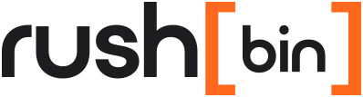
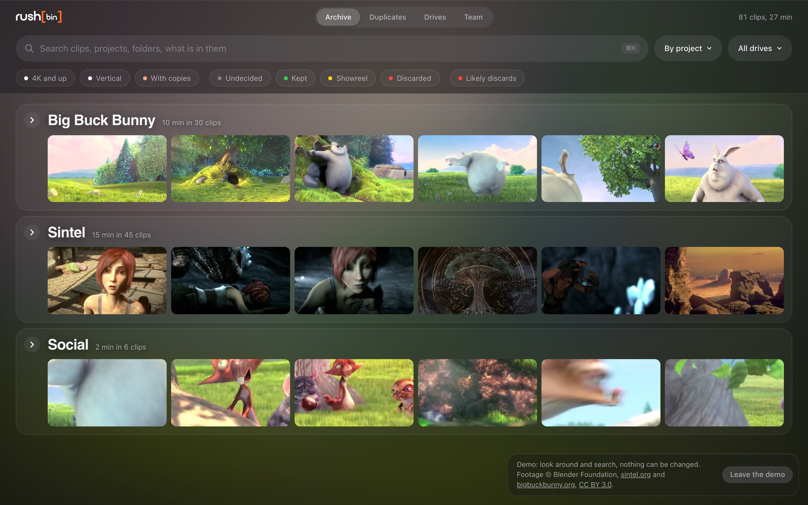

<p align="center">
  <picture>
    <source media="(prefers-color-scheme: dark)" srcset="docs/img/wordmark-dark-bg.svg">
    
  </picture>
</p>

<h3 align="center">Every clip on every drive, searchable even when the drive is on the shelf.</h3>

<p align="center">
  <a href="https://github.com/artideinnova/rushbin/actions/workflows/ci.yml"></a>
  <a href="LICENSE.md"></a>
  
  
  <a href="docs/self-host.md"></a>
</p>

<p align="center">
  <a href="https://rushbin.io/download/mac"><b>Download for Mac</b></a>
  &nbsp;|&nbsp; <a href="https://rushbin.io">rushbin.io</a>
  &nbsp;|&nbsp; <a href="docs/self-host.md">Run your own site</a>
  &nbsp;|&nbsp; <a href="https://rushbin.io/guides">Guides</a>
</p>



## What it does

<table>
  <tr><td><b>Catalog every drive</b></td><td>Connect a drive: every clip gets five frames, its metadata and a place in the archive. Nothing is written to the drive.</td></tr>
  <tr><td><b>Watch anything, raw too</b></td><td>H.264, HEVC, ProRes, MXF and more on the fly; RED R3D, Nikon N-RAW and ProRes RAW developed on the GPU.</td></tr>
  <tr><td><b>Real duplicates</b></td><td>Same size, same first and last MiB, then the same SHA-256: only true copies, never names.</td></tr>
  <tr><td><b>Search inside clips</b></td><td>Words on screen, what is said (Whisper) and what the frames show (SigLIP 2), all on your computer.</td></tr>
  <tr><td><b>Compare drives</b></td><td>What is on both, what only one has, and what you would lose with each.</td></tr>
  <tr><td><b>Work as a team</b></td><td>Invite colleagues, decide together, watch any clip in a browser with the drive unplugged.</td></tr>
</table>

> [!WARNING]
> **Status: pre-release.** In use at Artide, the Italian company that makes rushbin. The Mac app is signed and notarized by Apple and updates itself.

## Run your own site

> [!TIP]
> The official Mac app, signed and notarized by Apple, connects to **any** rushbin site over HTTPS: your own server, no account with anyone else. Rather not run a server? [rushbin.io](https://rushbin.io) hosts it for you.

```sh
sudo git clone https://github.com/artideinnova/rushbin /opt/rushbin && cd /opt/rushbin/deploy
# 1. an A record for rushbin.example.com pointing to this server, ports 80 and 443 open
# 2. the settings, readable by root only
sudo sh -c 'umask 077; printf "RUSHBIN_DOMAIN=rushbin.example.com\nPOSTGRES_PASSWORD=%s\nRUSHBIN_APP_PASSWORD=%s\n" "$(openssl rand -hex 24)" "$(openssl rand -hex 32)" > .env'
# 3. build and start rushbin, Postgres, search and Caddy (HTTPS by itself)
sudo ./up.sh
# 4. the link that creates your team: open it in a browser
sudo docker compose exec rushbin /rushbin setup-link
# 5. install the Mac app and connect it from the site's Team tab
```

Step by step, and what you can add (video from anywhere, email through your SMTP server, nightly backups, AI, app updates): **[docs/self-host.md](docs/self-host.md)**.

## Formats

<p>
     
           
</p>

Orange: camera raw, on the Mac. RED R3D, R3D NE and N-RAW need the official app, which includes RED's SDK.

<details>
<summary><b>Everything the Mac and Windows apps do</b></summary>

Open the app and connect a drive. rushbin asks once whether to catalog it (and which top folders to skip), then keeps it up to date every time you connect it. Nothing is written to the drive.

- **Archive:** every clip by project, with five preview frames, search with suggestions (projects, folders, codecs) and quick filters.
- **Watch** clips of connected drives in the app: H.264 and HEVC as they are, anything else (MXF, ProRes, ProRes RAW, ...) converted on the fly with the Mac's hardware encoder. Camera raw too in the official Mac app: RED `.R3D` (RED ONE included), Nikon R3D NE and N-RAW (`.NEV`), read with RED's SDK and developed on the GPU.
- **Duplicates by content, not by name:** files with the same size, first and last MiB are candidates, and only the same SHA-256 makes them copies.
- **Search by content, on your computer:** Apple Vision reads text on screen and recognizes things (crowd, stage, sky, ...); Whisper (large-v3-turbo, on the GPU) writes down what is said, in any language; SigLIP 2 turns five frames of each clip into vectors, so the team site, and the Mac app alone (it downloads the text half once, 0.5 GB), finds clips by what they look like ("dog", "confetti", "elderly people singing"). Windows alone searches words only for now. One search box merges names, folders, words on screen, speech and looks. Blank or very short clips are marked as likely discards; you confirm with X. Everything automatic is labeled as such, a wrong line of a transcript can be hidden and a transcript marked checked: what each model does and how well, in [docs/ai.md](docs/ai.md).
- **Compare two drives** by content: what is on both and verified byte for byte, what only one has, and what exists on no other drive, so you know what you would lose with each.
- **Decide:** Keep (K), Showreel (S), Discard (X), and which copy of a duplicate to keep. Extra copies and discarded clips go to `_rushbin_trash` on their own drive, with the same path, only after you review and confirm. Nothing is ever deleted: you empty the trash yourself.

- **Windows:** `rushbin.exe` is the same engine; a double click opens the page in the browser. Drives are the letters other than the system one. Not signed yet, so Windows warns on first start. Search by content runs on Windows too: Whisper on any GPU with Vulkan, SigLIP 2 on any DirectX 12 GPU (DirectML), both on the CPU without one, and Windows OCR for text on screen (no labels).
- **Team:** in the Team tab, connect the app to your team's rushbin site. The drives it catalogs, their previews and every decision go to the team, and each decision shows who took it. Turn off **Send to the team** on a drive (or when it is first connected) and nothing of it leaves the computer; what the site had of it is removed.

</details>

<details>
<summary><b>Everything the team site does</b></summary>

The team site shows everyone the catalogs sent by the team's Macs, from any browser. Accounts use email and password; owners invite the others with a link that works once, as owner, editor (decides and sends drives from a Mac) or viewer (looks and searches). Owners also rename the team, change roles, make links for a new password, cancel invites, remove members, drives and Macs, export all of the team's data as a ZIP (catalogs, previews, decisions, what was found in the clips, members; light copies as links valid 7 days), and can delete the team.

One site can host many teams. Each team's rows are kept apart twice: every query filters on the request's team, and Postgres row level security shows the site's queries only that team's rows. It runs on one server with Docker: rushbin, Postgres and Caddy for HTTPS (`deploy/compose.yml`, instructions at the top of the file); `rushbin newteam` creates a team and prints its owner's invite.

**Video from anywhere:** with a store for the team (any S3-compatible bucket: R2, AWS S3, Backblaze, MinIO), the Mac that has a drive makes a light copy of each clip in the background (H.264, 1280 px, about 3 Mbit/s) and uploads it straight to the store with a link the site signs. Members then watch any clip from the browser or the app, with the drive unplugged; the links last one hour.

**The original, on request:** a member who needs a full-quality file asks for it from the site; the computer that has the drive uploads it to the store when the drive is connected, checks it, and the member gets a download link. Files expire after 7 days; the requests themselves are deleted after 90 days unused, like a computer's sign-in.

</details>

<details>
<summary><b>For developers</b></summary>

Needs Go (the version in `go.mod`) and FFmpeg on the `PATH`; the app build also needs the Xcode command line tools.

```sh
go test ./...                                     # builds fake drives with FFmpeg
go run . scan /Volumes/MyDrive                    # same catalog as the app
macos/build.sh /tmp/out                           # rushbin.app, universal, using the ffmpeg on the PATH
macos/build-ffmpeg.sh /tmp/ff                     # LGPL ffmpeg/ffprobe to bundle: macos/build.sh /tmp/out /tmp/ff
```

`SIGN_ID` (Developer ID) and `NOTARY_PROFILE` (notarytool keychain profile) make a signed, notarized DMG.

- `scan.go`: inventory and full hashes, per drive under `~/Library/Application Support/rushbin/disks/<volume UUID>/` (`device.json`, `files.jsonl`, `fullhash.tsv`).
- `catalog.go`: the catalog in memory, rebuilt from those files after each scan, plus `decisions.jsonl`.
- `app.go`, `live.go`: the engine of the Mac app, serving `web/index.html` on 127.0.0.1 to the app window only.
- `vision.go`, `macos/vision.swift`: Apple Vision on the previews (`vision.jsonl`), suggestions and labels.
- `compare.go`: two drives by content. `search.go`: search (reciprocal rank fusion of words and looks, pgvector). `text.go`: search by looks in the Mac app alone (SigLIP 2 tokenizer, nearest frames). `speech.go`: Whisper. `original.go`: originals on request. `platform_*.go`: what differs on Windows.
- `server.go`: the team site (`rushbin serve`, `DATABASE_URL`, `RUSHBIN_S3_*` for the store); `team.go`: the app's link to it; `proxy.go`: the light copies; `s3.go`: signed links (SigV4). Server tests need `RUSHBIN_TEST_DB`, an admin URL of a Postgres they can create databases in.
- `macos/`: the app shell (`main.swift`), its build and the ffmpeg build. `windows/vision/`: `rushbin-vision.exe`, the Windows twin of `macos/vision.swift` (built in CI).

</details>

## License

> [!IMPORTANT]
> rushbin is **source-available** under the [Functional Source License 1.1, Apache 2.0 future license](LICENSE.md) (FSL-1.1-ALv2). You can read, change and run it, and self-host it for any purpose, except offering a competing commercial product or service. Each version becomes Apache 2.0, a fully open source license, two years after it is published.

- **Name and logo:** not covered by the license, see [TRADEMARKS.md](TRADEMARKS.md).
- **Software by others in rushbin:** [NOTICE.md](NOTICE.md).
- **RED's SDK** is never part of this repository: the official Mac app includes RED's libraries under RED's own license to read R3D and N-RAW; an app built from this repository lists those clips as plain files.

## Contributing and security

Pull requests are welcome: read **[CONTRIBUTING.md](CONTRIBUTING.md)** first. Report vulnerabilities privately as **[SECURITY.md](SECURITY.md)** says. Everyone follows the [code of conduct](CODE_OF_CONDUCT.md).
